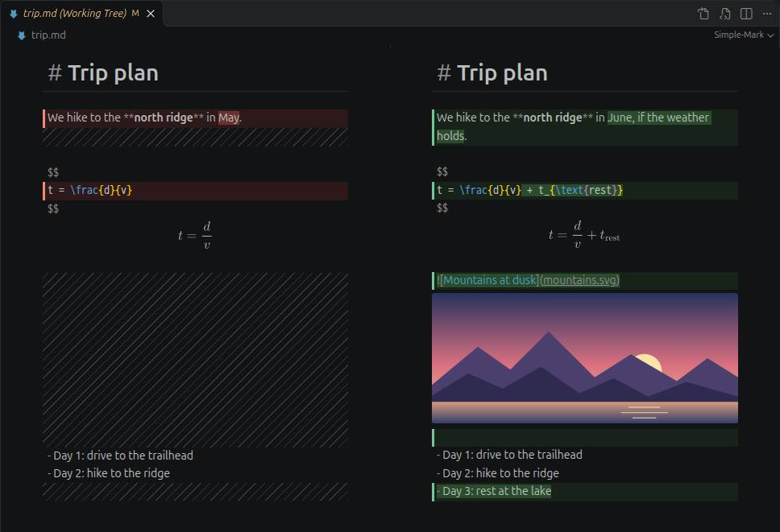
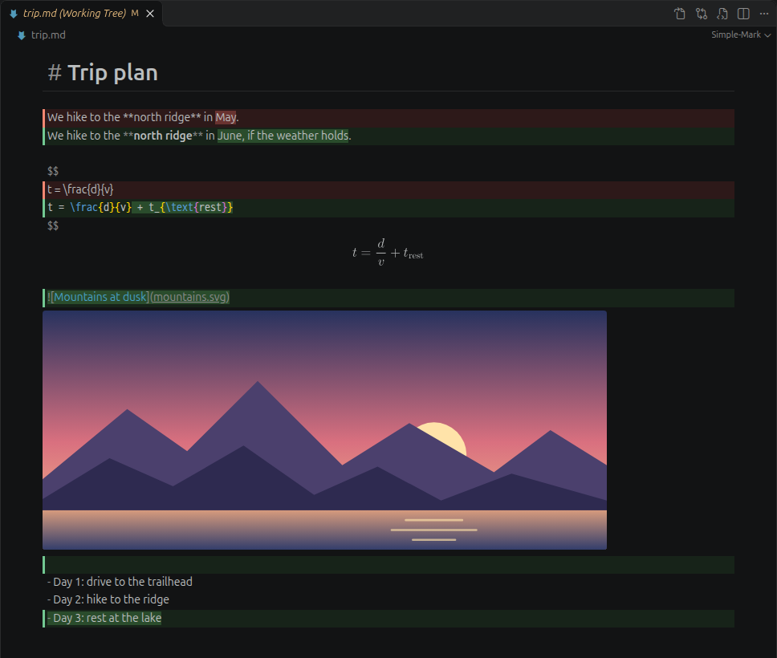
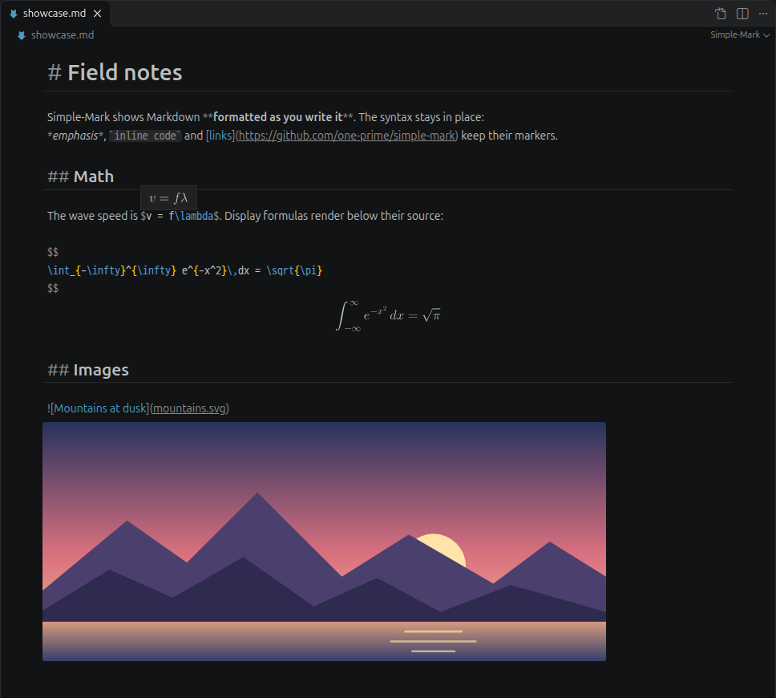

<p align="center">
  
</p>

<h1 align="center">Simple-Mark</h1>

<p align="center">
  <b>Markdown that looks like the result, with its syntax still in place.</b><br>
  A Markdown editor for VS Code: styled text, rendered math, image previews and Git diffs.
</p>

<p align="center">
  <a href="https://github.com/one-prime/simple-mark/releases/latest"></a>
  
  <a href="LICENSE"></a>
</p>

<p align="center">
  <a href="#see-your-changes-in-a-diff">Diffs</a> ·
  <a href="#what-you-see-is-what-you-write">Features</a> ·
  <a href="#install">Install</a> ·
  <a href="#for-developers">For developers</a>
</p>

## See your changes in a diff

Click a changed Markdown file in **Source Control**. VS Code's diff editor opens in
Simple-Mark: both versions keep their formatting, formulas and images, and the changes are
marked in VS Code's diff colors.



| Layout | What you see |
| --- | --- |
| **Side by side** | The old version on the left, the new one on the right. Removed lines are red, added lines green, changed words darker. Hatched space fills in for lines that only one side has, so both sides line up and scroll together. |
| **Inline** | One editor. Removed lines appear in red above the green lines that replaced them. |

- Switch the layout with **Toggle Inline View** in the editor title bar.
- Edit the working file right in the diff. **Ctrl+S** saves, and undo and redo work a word at
  a time, as in VS Code's text editor.
- The same view opens for **Open Changes**, the Timeline and **Compare Selected**.

<details>
<summary><b>Show the inline layout</b></summary>



</details>

> [!IMPORTANT]
> The diff editor uses a proposed VS Code API (VS Code 1.143 or newer). Allow it once:
>
> 1. Run **Preferences: Configure Runtime Arguments**. This opens `argv.json`.
> 2. Add `"enable-proposed-api": ["Simple-Mark.simple-mark"]`.
> 3. Quit VS Code completely and start it again.
>
> Without this, a diff shows two plain Simple-Mark editors, and Simple-Mark shows these steps
> once.

## What you see is what you write

The text stays plain Markdown. Simple-Mark only draws it: `# Heading` keeps its `#` and
appears large, `**bold**` keeps its stars and appears bold.



<table>
<tr>
<td width="33%" valign="top">

### ✍️ Markdown

Headings, **bold**, *italic*, `code`, links, lists and quotes appear styled. Their markers
stay visible and dimmed, so you always see what you type.

</td>
<td width="33%" valign="top">

### ∑ Math

`$inline$` math shows a rendered tooltip. `$$` blocks render below their source. Use the
same TeX syntax as KaTeX and VS Code's preview; Simple-Mark renders it with MathJax. The TeX
is colored, so an unmatched brace stands out.

</td>
<td width="33%" valign="top">

### 🖼️ Images

Images preview below their line. Paths are relative to the document, or to the workspace
for paths that start with `/`. Click a preview to open the image.

</td>
</tr>
</table>

### And more

- **Tables:** Tab and Shift+Tab move between cells, Enter adds a row, and the columns
  re-align. Korean, Chinese and Japanese text lines up too.
- **Code blocks** are colored by their language (190+ languages).
- **Links:** Ctrl+Click (⌘+Click on macOS) opens web pages, files and `#heading` links.
- **Tab** indents as in VS Code's text editor.
- Long documents scroll smoothly: the scrollbar thumb stays under the mouse.
- Follows your color theme. Saving, undo and Git work as with any text file.

## Install

1. Download `simple-mark-<version>.vsix` from the
   [latest release](https://github.com/one-prime/simple-mark/releases/latest).
2. In VS Code, run **Extensions: Install from VSIX…** and select the file.
3. Open a `.md` file. It opens in Simple-Mark.

To see the plain text, click **Open as Text** in the editor title bar. For settings and
details, see the [extension README](packages/vscode/README.md).

## For developers

This repository contains the VS Code extension and the TypeScript libraries behind it.

| Package | Purpose |
| --- | --- |
| [@simple-mark/codemirror](packages/codemirror/README.md) | CodeMirror 6 editor and extensions |
| [@simple-mark/model](packages/model/README.md) | Markdown parsing, styled ranges, themes, and table utilities |
| [@simple-mark/math](packages/math/README.md) | TeX-to-SVG rendering with MathJax |
| [@simple-mark/highlight](packages/highlight/README.md) | Code highlighting with languages loaded on demand |
| [@simple-mark/canvas](packages/canvas/README.md) | Markdown layout and drawing on a canvas |
| [VS Code extension](packages/vscode/README.md) | Markdown editing integrated with VS Code |

The packages use npm workspaces, so local development links them together. The extension
has its own version and VSIX packaging command; library releases use a separate command.

### Use the editor in an application

```bash
npm install @simple-mark/codemirror
```

Given an HTML element such as `<div id="editor"></div>`:

```ts
import { createEditor } from '@simple-mark/codemirror';

const view = createEditor(document.getElementById('editor')!, {
  doc: '# Hello **world**\n',
  onChange: (text) => console.log(text),
});

// When the editor is no longer needed:
// view.destroy();
```

See the [editor options](packages/codemirror/README.md) for image and link handling.
When bundling the editor, configure the [MathJax font alias](packages/math/README.md)
so it uses the intended font.

### Develop locally

Use Node.js 24 or newer and npm. Run these commands from the repository root:

```bash
git clone https://github.com/one-prime/simple-mark.git
cd simple-mark
npm ci
npm run dev
```

Open <http://localhost:5180> to try the browser editor demo
(<http://localhost:5180/?long> for a long document with images and formulas).

Run the project checks with:

```bash
npm run typecheck
npm test
```

See [DESIGN.md](DESIGN.md) for the editor's design and architecture.

### Build the VS Code extension

From the repository root, after installing dependencies:

```bash
npm run package -w packages/vscode
```

This builds the extension and produces `packages/vscode/simple-mark-<version>.vsix`.
See the [extension README](packages/vscode/README.md#building-from-source) for its checks
and for the script that takes the screenshots above.

### Package the libraries

To build the reusable packages and create npm tarballs locally:

```bash
npm run release -- --pack
```

The tarballs are written to `dist/release/`. This command does not publish to npm.
The [release script](scripts/release.mjs) documents dry-run and publishing options.

## Feedback and contributions

Report bugs and feature requests in [GitHub Issues](https://github.com/one-prime/simple-mark/issues).
For extension issues, include your VS Code version and a small Markdown example that
reproduces the problem. For library issues, include the package name and version.

## License

[MIT](LICENSE). Third-party dependencies retain their own licenses. See
[licenses/README.md](licenses/README.md) and the generated `THIRD_PARTY_NOTICES.txt`
files for license texts and credits.
