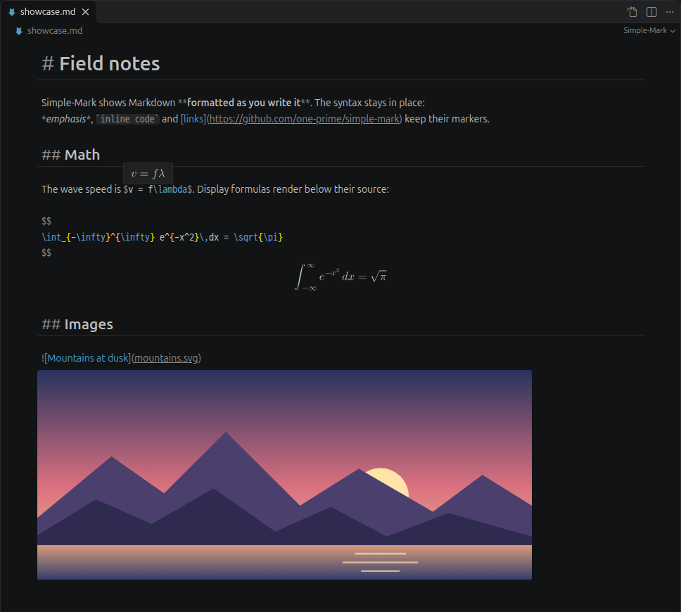
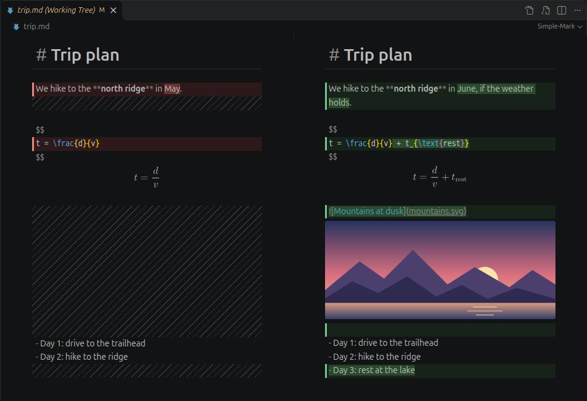
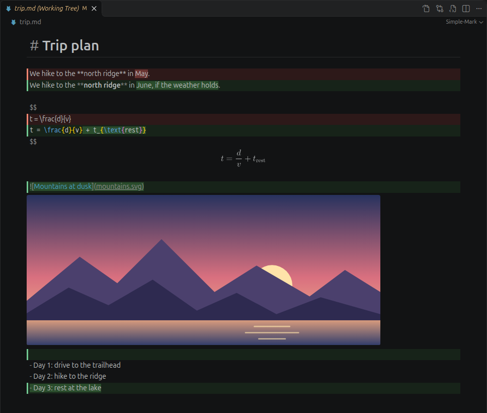

# Simple-Mark for VS Code

**Markdown that looks like the result, with its syntax still in place.**

`# Heading` keeps its `#` and appears large. `**bold**` keeps its stars and appears bold.
Formulas and images render next to their source. The file stays plain Markdown, and an
unedited document keeps its original line endings.



## See your changes in a diff

Click a changed Markdown file in **Source Control**. VS Code's diff editor opens in
Simple-Mark: both versions keep their formatting, formulas and images, and the changes are
marked in VS Code's diff colors. The same view opens for **Open Changes**, the Timeline and
**Compare Selected**.



| Layout | What you see |
| --- | --- |
| **Side by side** | The old version on the left, the new one on the right. Removed lines are red, added lines green, changed words darker. Hatched space fills in for lines that only one side has, so both sides line up and scroll together. |
| **Inline** | One editor. Removed lines appear in red above the green lines that replaced them. |



- The layout follows your `diffEditor.renderSideBySide` setting. To switch, use **Toggle
  Inline View** in the editor title bar (or the Command Palette).
- Edit the working file in the diff, in either layout. The changes are marked again as you
  type. **Ctrl+S** saves, and **Ctrl+Z** / **Ctrl+Y** undo and redo a word at a time, as in
  VS Code's text editor. Earlier versions from Git are read-only.
- Removed lines in the inline layout are shown as plain text, without Simple-Mark's styling.

### Allow the diff API

The diff editor uses `customEditorDiffs`, a proposed VS Code API (VS Code 1.143 or newer).
Stable VS Code allows proposed APIs only for extensions that you name:

1. Run **Preferences: Configure Runtime Arguments**. This opens `argv.json`.
2. Add this entry:

   ```json
   "enable-proposed-api": ["Simple-Mark.simple-mark"]
   ```

3. Quit VS Code completely and start it again.

You can also start VS Code with `code --enable-proposed-api Simple-Mark.simple-mark`.
Without this permission, a diff shows two plain Simple-Mark editors with no changes marked.
Simple-Mark then shows a notification once with these steps.

To keep VS Code's text diff for Markdown, add to your settings:

```json
{
  "workbench.diffEditorAssociations": {
    "*.md": "default",
    "*.markdown": "default"
  }
}
```

## What you see is what you write

| | |
| --- | --- |
| ✍️ **Markdown** | Headings, **bold**, *italic*, `code`, links, lists and quotes appear styled. Their markers stay visible and dimmed. |
| ∑ **Math** | `$inline$` math shows a rendered tooltip. `$$` blocks render below their source. Use the same TeX syntax as KaTeX and VS Code's preview; Simple-Mark renders it with MathJax. The TeX is colored: commands, brackets in your bracket pair colors, an unmatched brace in red. |
| 🖼️ **Images** | Images preview below their line. Paths are relative to the document (see Links for paths starting with `/`). Click a preview to open the image. |

### And more

- **Tables**: Tab / Shift+Tab move between cells, Enter adds a row; each re-aligns the
  table. Korean and other wide characters line up.
- **Code blocks** are colored by their language, as in VS Code's Markdown preview
  (highlight.js, 190+ languages).
- **Links**: Ctrl+Click (⌘+Click on macOS) opens a link: web pages in your browser (VS Code
  asks first), `#heading` links jump within the document, and paths open in VS Code — images
  in its image viewer, Markdown files in Simple-Mark. Paths are relative to the document. A
  path starting with `/` is an absolute path on disk, or else relative to the workspace folder
  (as in VS Code's own Markdown preview); images are found the same way.
- **Tab** indents as in VS Code's text editor, by your `editor.tabSize` and
  `editor.insertSpaces` for Markdown; Shift+Tab outdents. Ctrl+M switches Tab to moving the
  focus.
- **Long documents**: the scrollbar thumb stays under the mouse, also while images and
  formulas are still loading.
- Follows your color theme, styled like VS Code's Markdown preview. Saving, undo/redo and Git
  work as with any text editor.

## Installation

Requires **VS Code 1.100.0 or newer**; the diff editor needs VS Code 1.143 or newer.

### From a VSIX file

1. Download `simple-mark-<version>.vsix` from the
   [latest GitHub release](https://github.com/one-prime/simple-mark/releases/latest).
2. Open the Command Palette and run **Extensions: Install from VSIX…**.
3. Select the file, then open a Markdown file.

To build a VSIX yourself, see [Building from source](#building-from-source).

### From the Marketplace

Open Extensions in VS Code and search for `@id:Simple-Mark.simple-mark`, or visit the
[Simple-Mark Marketplace listing](https://marketplace.visualstudio.com/items?itemName=Simple-Mark.simple-mark).
The Marketplace does not accept extensions that use proposed APIs, so the diff editor is
only in the GitHub release.

## Usage

Simple-Mark is the default editor for `.md` and `.markdown` files: open one and it opens in
Simple-Mark.

- **Open as Text** in the editor title bar (or **Reopen Editor With… → Text Editor**)
  shows the plain text.
- **Open with Simple-Mark** in the title bar or the Explorer context menu switches back.

To keep the plain text editor as your default instead, add to your settings:

```json
{
  "workbench.editorAssociations": {
    "*.md": "default",
    "*.markdown": "default"
  }
}
```

## Korean, Chinese and Japanese text in tables

Tables are padded counting each Korean, Chinese or Japanese character as two columns
(Unicode East Asian Width, the same rule Prettier uses), so the saved text is aligned.
Simple-Mark draws these characters exactly two columns wide, so its tables line up with any
font.

VS Code's plain text editor relies on its font instead. Unless the font draws these
characters exactly twice as wide as Latin letters, pipes after such text land too far left
there. To see tables aligned in the text editor too, use such a font, for example
[D2Coding](https://github.com/naver/d2codingfont) (Ubuntu: `sudo apt install fonts-naver-d2coding`):

```json
"editor.fontFamily": "'D2Coding', monospace"
```

This setting applies to every file. Noto Sans Mono CJK KR comes close but not exactly: its
Hangul is 1.84 columns wide, so a row with about six Korean characters ends one column short.

> **Warning:** Quit and restart VS Code completely after installing a font. VS Code runs on
> Chromium, which reads the list of installed fonts when it starts; "Reload Window" may not
> be enough. Until then, VS Code silently falls back to another font and the setting seems
> to have no effect.

## Notes

- Images load from the document's folder, the workspace and `https:` URLs only.
- Math supports common TeX packages; commands that create links or HTML (`\href`,
  `\style`) are not available.

## Source and feedback

The extension is maintained in the
[Simple-Mark repository](https://github.com/one-prime/simple-mark), alongside the editor
libraries it uses. Its source is in
[`packages/vscode`](https://github.com/one-prime/simple-mark/tree/main/packages/vscode).

[Report a bug or request a feature](https://github.com/one-prime/simple-mark/issues).
For bugs, include your VS Code version, operating system, and a small Markdown example
that reproduces the issue.

## Building from source

Use Node.js 24 or newer and npm. Clone the full repository so the extension can use the
shared workspace packages and build scripts:

```bash
git clone https://github.com/one-prime/simple-mark.git
cd simple-mark
npm ci
npm run package -w packages/vscode
```

The package command builds the extension and writes
`packages/vscode/simple-mark-<version>.vsix`. Install it using **Extensions: Install from
VSIX…** in VS Code.

From the repository root, run type checks and tests with:

```bash
npm run typecheck
npm test
```

For the webview smoke check, first build the extension with
`npm run build -w packages/vscode`, then run `npm run smoke -w packages/vscode`.
The smoke check requires Chromium in Playwright's cache or a `CHROMIUM_PATH` environment
variable pointing to a Chromium executable.

To check the extension in a real VS Code, run `npm run e2e -w packages/vscode` after the
build. It checks the diff editor (both layouts, with editing) and a fast scrollbar drag
through a long document. Headless browsers ignore scrollbar drags, so only a real window can
test that. The test starts VS Code 1.143 or newer (`/usr/share/code/code`, or set
`VSCODE_PATH`) with a temporary profile and Git repository. A VS Code window opens during the
test. Set `SMOKE_SHOTS=<folder>` with either check to save screenshots.

The screenshots in this README come from `npm run screenshots -w packages/vscode` (after the
build). It opens sample documents and a Git change in a real VS Code window and saves
`images/*.png`.

## License

MIT. The extension includes CodeMirror, Lezer, MathJax (with its font) and highlight.js, each
under its own license; `THIRD_PARTY_NOTICES.txt` in the extension has their full license
texts, along with credits for the styles of VS Code's Markdown preview it follows.
